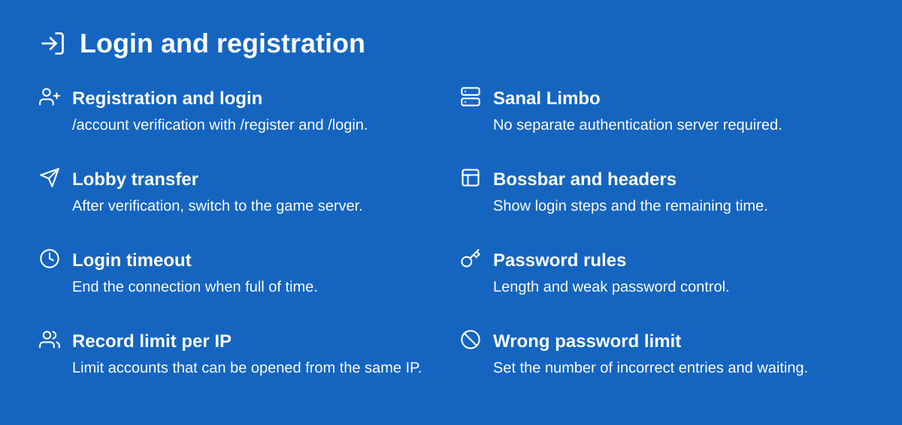
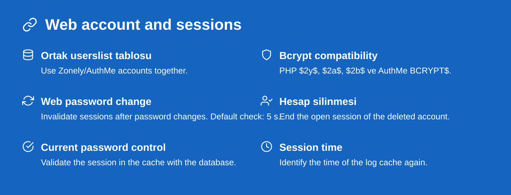
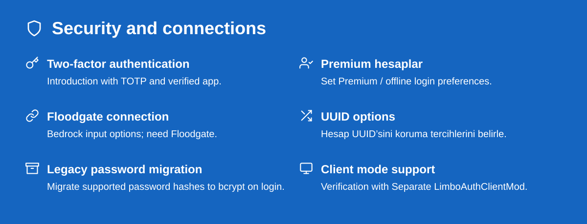
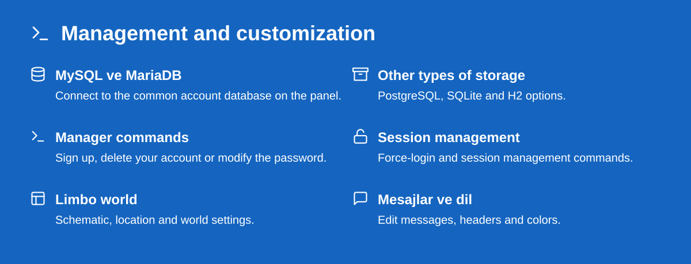

  

  <a href="https://github.com/zonely-gen-tr/zonely-limboauth/releases/download/v1.1.15-zonely.3/limboauth-1.1.15-zonely.3.jar">Download LimboAuth</a> · <a href="https://github.com/zonely-gen-tr/zonely-limboauth/releases/tag/v1.1.15-zonely.3">LimboAPI and packages</a> · <a href="https://github.com/zonely-gen-tr/zonely-limboauth/releases/download/v1.1.15-zonely.3/SHA256SUMS.txt">SHA-256 checksums</a> · <a href="docs/KURULUM.md">Installation guide</a>

Let players use their website accounts to log in to Minecraft. **Zonely LimboAuth** handles registration and login in a virtual Limbo world on Velocity. It uses the shared Zonely / AuthMe `userslist` table and transfers authenticated players to the lobby. A separate Paper authentication server is not required.

This adaptation is based on [Elytrium LimboAuth](https://github.com/Elytrium/LimboAuth) and is distributed independently under **GNU AGPL v3**.

When the web panel writes a new bcrypt hash to `userslist.password`, the active game session is invalidated by the periodic check, which defaults to **5 seconds**. The player then logs in with the new password. No additional webhook or web token is required.

Floodgate and client mode require their respective software and configuration. Premium login behavior depends on your settings.

## Installation

1. Download the **LimboAuth JAR** and the **LimboAPI JAR matching your Velocity version** from [Releases](https://github.com/zonely-gen-tr/zonely-limboauth/releases/tag/v1.1.15-zonely.3).
2. Place both in Velocity's `plugins/` folder. Keep one JAR per plugin.
3. Start and stop the proxy once. Configure database and login settings in `plugins/limboauth/config.yml`.
4. Set the lobby address in `velocity.toml`, restart the proxy and test with a sample account.

Install the plugins on **Velocity**. Configure the destination Paper / Spigot lobby separately. The [installation guide](docs/KURULUM.md) includes MySQL examples, column mappings and source-build instructions.

| Velocity | LimboAPI file | Java |
| --- | --- | --- |
| 3.4.0 | `limboapi-1.1.27-velocity-3.4.0.jar` | 21 |
| 3.5.1 | `limboapi-1.1.27-velocity-3.5.1.jar` | 25 |
| 4.2.0 | `limboapi-1.1.27-velocity-4.2.0.jar` | 25 |

The same LimboAuth JAR is used across these versions. Select LimboAPI for your proxy version. See [TESTING.md](TESTING.md) for verified proxy builds and Minecraft clients. **Minecraft Java 1.20.4** was also tested with Velocity 3.4.0, Paper 1.20.4 and a shared MySQL account.

Player and administrator commands

| Player command | Purpose |
| --- | --- |
| `/register <password> <password>` | Create an account. |
| `/login <password>` | Log in. |
| `/changepassword <old> <new>` | Change the password. |
| `/destroysession` | End the remembered login session. |
| `/2fa enable [password]` | Enable TOTP verification. |
| `/2fa disable <code>` | Disable TOTP verification. |
| `/premium <password> confirm` | Enable premium account mode. |
| `/unregister <password> confirm` | Delete the account. |

| Administrator command | Permission |
| --- | --- |
| `/forceregister <player> <password>` | `limboauth.admin.forceregister` |
| `/forceunregister <player>` | `limboauth.admin.forceunregister` |
| `/forcechangepassword <player> <password>` | `limboauth.admin.forcechangepassword` |
| `/forcelogin <player>` | `limboauth.admin.forcelogin` |
| `/limboauth reload` | `limboauth.admin.reload` |

Configure command access through `main.command-permission-state`. Use `/2fa <code>` during TOTP login.

For a shared website database, the default `main.protect-website-accounts: true` setting blocks `/unregister`, `/forceunregister` and `/premium`. If legacy duplicate records exist, the lowest ID is selected. See [shared database and password compatibility](docs/ZONELY_SHARED_DATABASE.md).

## File verification and credits

SHA-256 checksums for `limboauth-1.1.15-zonely.3.jar` and the packages are included in `SHA256SUMS.txt` in the release assets.

[Release files and checksums](https://github.com/zonely-gen-tr/zonely-limboauth/releases/tag/v1.1.15-zonely.3) · [Report an issue](https://github.com/zonely-gen-tr/zonely-limboauth/issues)

The source is licensed under [GNU AGPL v3](LICENSE). Copyright notices for Elytrium LimboAuth, LimboAPI and contributors are retained. LimboAPI source archives are included with releases. The [Feather icons](docs/assets/FEATHER-LICENSE.txt) use the MIT license. See [third-party notices](docs/THIRD_PARTY_NOTICES.md).
