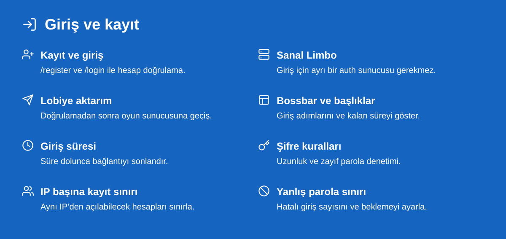
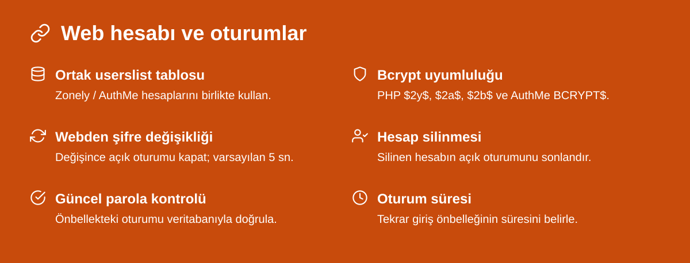
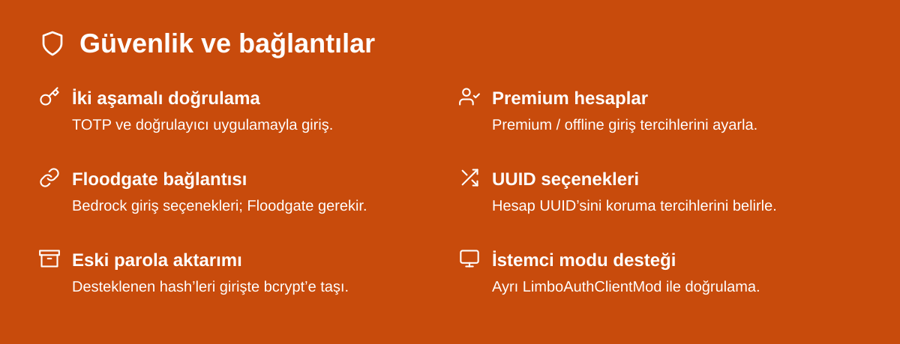
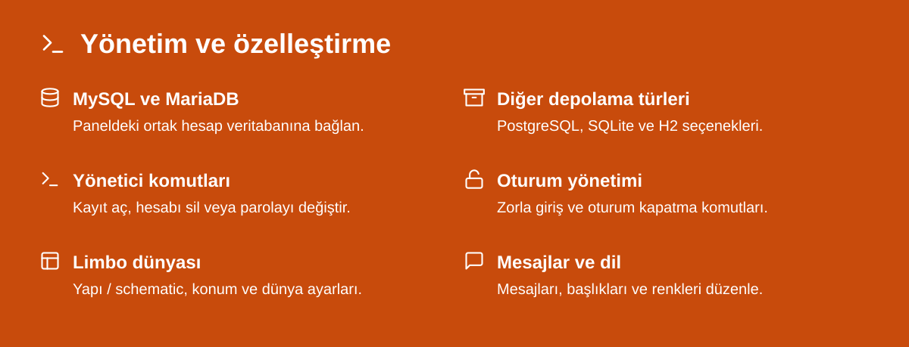

  

  <a href="https://github.com/zonely-gen-tr/zonely-limboauth/releases/download/v1.1.15-zonely.3/limboauth-1.1.15-zonely.3.jar">LimboAuth indir</a> · <a href="https://github.com/zonely-gen-tr/zonely-limboauth/releases/tag/v1.1.15-zonely.3">LimboAPI ve paketler</a> · <a href="https://github.com/zonely-gen-tr/zonely-limboauth/releases/download/v1.1.15-zonely.3/SHA256SUMS.txt">SHA-256 değerleri</a> · <a href="docs/KURULUM.md">Kurulum rehberi</a>

Oyuncu web hesabıyla Minecraft’a da giriş yapsın. **Zonely LimboAuth**, Velocity üzerinde sanal bir Limbo dünyasında kayıt ve giriş işlemlerini yürütür. Zonely / AuthMe’nin ortak `userslist` tablosuyla çalışır; doğrulanan oyuncuyu lobiye aktarır. Giriş aşaması için ayrı bir Paper sunucusu kurmanız gerekmez.

[Elytrium LimboAuth](https://github.com/Elytrium/LimboAuth) tabanlı bir uyarlamadır; Elytrium’un resmi dağıtımı değildir. Kaynak kod **GNU AGPL v3** lisansıyla paylaşılır.

Web paneli yeni bcrypt özetini aynı `userslist.password` alanına yazdığında açık oyun oturumu varsayılan **5 saniyelik kontrolle** kapatılır. Oyuncu yeni şifresiyle yeniden giriş yapar. Ek webhook veya web-token gerekmez.

Floodgate ve istemci modu bağlantıları ilgili ek yazılımları ve ayarlarını gerektirir. Premium giriş davranışı yapılandırmaya bağlıdır.

### Kurulum

1. [Sürüm sayfasından](https://github.com/zonely-gen-tr/zonely-limboauth/releases/tag/v1.1.15-zonely.3) **LimboAuth JAR’ını** ve kullandığınız Velocity’ye eşleşen **LimboAPI JAR’ını** indirin.
2. İkisini Velocity’nin `plugins/` klasörüne koyun. Her eklentiden tek JAR bırakın.
3. Proxy’yi bir kez başlatıp kapatın. `plugins/limboauth/config.yml` içindeki veritabanı ve giriş ayarlarını düzenleyin.
4. `velocity.toml` içindeki lobi adresini ayarlayın, proxy’yi yeniden başlatın ve bir deneme hesabıyla giriş yapın.

Eklentiler **Velocity’ye kurulur**. Oyuncunun giriş sonrası ulaşacağı Paper / Spigot lobisi ayrı olarak tanımlanır. Ayrıntılı MySQL örneği, kolon eşlemeleri ve kaynak derleme adımları [kurulum rehberinde](docs/KURULUM.md).

| Velocity | LimboAPI dosyası | Java |
| --- | --- | --- |
| 3.4.0 | `limboapi-1.1.27-velocity-3.4.0.jar` | 21 |
| 3.5.1 | `limboapi-1.1.27-velocity-3.5.1.jar` | 25 |
| 4.2.0 | `limboapi-1.1.27-velocity-4.2.0.jar` | 25 |

LimboAuth JAR’ı ortaktır; LimboAPI dosyası proxy’ye göre seçilir. Doğrulanan proxy derlemeleri ve Minecraft istemci sürümleri [TESTING.md](TESTING.md) içinde listelenir. **Minecraft Java 1.20.4**, Velocity 3.4.0 + Paper 1.20.4 + ortak MySQL hesabıyla ayrıca test edilmiştir.

Oyuncu ve yönetici komutları

| Oyuncu komutu | İşlev |
| --- | --- |
| `/register <şifre> <şifre>` | Hesap oluşturur. |
| `/login <şifre>` | Hesaba giriş yapar. |
| `/changepassword <eski> <yeni>` | Parolayı değiştirir. |
| `/destroysession` | Tekrar giriş oturumunu kapatır. |
| `/2fa enable [şifre]` | TOTP doğrulamasını açar. |
| `/2fa disable <kod>` | TOTP doğrulamasını kapatır. |
| `/premium <şifre> confirm` | Premium hesap modunu etkinleştirir. |
| `/unregister <şifre> confirm` | Hesabı siler. |

| Yönetici komutu | Yetki |
| --- | --- |
| `/forceregister <oyuncu> <şifre>` | `limboauth.admin.forceregister` |
| `/forceunregister <oyuncu>` | `limboauth.admin.forceunregister` |
| `/forcechangepassword <oyuncu> <şifre>` | `limboauth.admin.forcechangepassword` |
| `/forcelogin <oyuncu>` | `limboauth.admin.forcelogin` |
| `/limboauth reload` | `limboauth.admin.reload` |

Komut erişimleri `main.command-permission-state` ayarlarından düzenlenir. TOTP giriş ekranında `/2fa <kod>` kullanılır.

Ortak web veritabanında varsayılan `main.protect-website-accounts: true` ayarı `/unregister`, `/forceunregister` ve `/premium` işlemlerini engeller. Eski yinelenen kayıtlar arasında en küçük ID seçilir. [Ortak veritabanı ve parola uyumluluğu](docs/ZONELY_SHARED_DATABASE.md).

### Dosya doğrulama ve kaynaklar

`limboauth-1.1.15-zonely.3.jar` ve paketlerin SHA-256 değerleri sürüm ekindeki `SHA256SUMS.txt` dosyasında bulunur.

[Sürüm dosyaları ve SHA256SUMS](https://github.com/zonely-gen-tr/zonely-limboauth/releases/tag/v1.1.15-zonely.3) · [Hata bildir](https://github.com/zonely-gen-tr/zonely-limboauth/issues)

Kod [GNU AGPL v3](LICENSE) kapsamındadır. Elytrium LimboAuth / LimboAPI ve katkıda bulunan geliştiricilerin telif bildirimleri korunur. LimboAPI kaynak arşivleri sürüm eklerinde bulunur. Görsellerdeki [Feather ikonları](docs/assets/FEATHER-LICENSE.txt) MIT lisanslıdır; [üçüncü taraf bildirimleri](docs/THIRD_PARTY_NOTICES.md).
